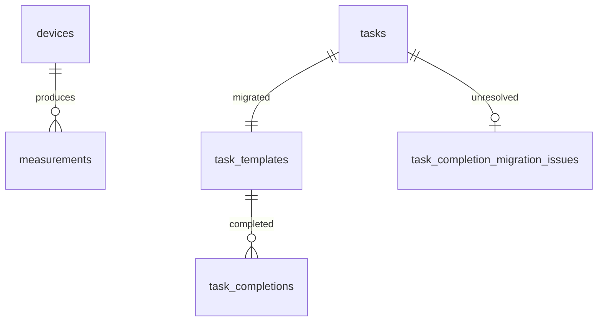

# Backend после BE-05

BE-01 разделяет сервер и фиксирует контракт. BE-02 добавляет сравнимое время UTC,
явное происхождение времени истории и схему ежедневных задач с переносом данных.
BE-03 нормализует время при сравнении повторов и делает сохранение измерения транзакционным.
BE-04 добавляет фильтры и страницы истории, а также независимые последние значения
каждой метрики. BE-05 добавляет агрегированные ряды по всему диапазону с ограниченным
числом точек и явными пробелами. Свежесть по метрикам и задачи по датам остаются
следующими задачами [плана](backend-plan.md).

## Границы модулей

```text
React / simulator
       │ HTTP JSON
       ▼
api/   DTO, handlers, extractors, Problem Details
       │ валидированные значения / результаты
       ├──────────────► domain/  чистые проверки и расчёты
       │
       ▼
storage/  SQL-запросы и преобразование SQLite rows
       │
       ▼
SQLite (миграции 0001, 0002 и индексы 0003)
```

| Область | Обязанность | Владелец |
|---|---|---|
| lib.rs | Сборка маршрутов; сохраняет `app(pool, dist) -> Router` | Ты |
| api/ | Публичные DTO, HTTP-статусы, обработчики, extraction и единые ошибки | Ты |
| domain/ | Модели, проверки измерений, расчёт текущей свежести, семантика задач | Ты |
| storage/ | Запросы SQLite; без HTTP-ответов и кодов HTTP | iwbhappy |
| main.rs | Настройки, создание pool, миграции, listener и завершение | iwbhappy |
| migrations/, simulator/, scripts/ | Схема, генератор данных и запуск | iwbhappy |
| tests/ | Интеграционные проверки по соответствующей функции | Оба |

domain не зависит от Axum и SQLx. storage принимает/возвращает типы domain;
api преобразует wire DTO и решает, какой HTTP-ответ отправить. Не создаём
универсальный repository framework или дополнительный слой микросервисов.

### Внутренние интерфейсы

Все функции storage асинхронные и возвращают `Result<…, sqlx::Error>`.
В HTTP-ошибки их преобразует слой api.

| Функция | Вход | Успешный результат |
|---|---|---|
| storage::check_connection | `&SqlitePool` | `()` |
| storage::measurements::device | `&SqlitePool`, `device_id: &str` | `Option<Device>` |
| storage::measurements::history | `&SqlitePool`, `astronaut_id: &str`, `&HistoryQuery` | `HistoryPage {items, has_more, next_cursor}` |
| storage::measurements::latest_by_metric | `&SqlitePool`, `astronaut_id: &str` | `Vec<LatestMetric>` с шестью метриками |
| storage::measurements::latest_received | `&SqlitePool`, `astronaut_id: &str` | `Option<Measurement>` |
| storage::measurements::insert_or_get | `&SqlitePool`, `&NewMeasurement`, `&Device`, `received_at: &str` | `InsertOutcome {measurement, created}` |
| storage::series::aggregate | `&SqlitePool`, `astronaut_id: &str`, `&SeriesQuery` | `Vec<BucketAggregate>` только непустых интервалов по возрастанию индекса |
| storage::tasks::list | `&SqlitePool` | `Vec<Task>` |
| storage::tasks::set_completion | `&SqlitePool`, `id: &str`, `Option<DateTime<Utc>>` | `Option<Task>` |

Проверка совпадения payload повторного сообщения выполняется в domain через
`Measurement::matches_payload`. storage сообщает, создана ли запись, и возвращает
сохранённые значения; выбор 200/201/409 остаётся в api.

Чистые функции/методы domain:

- `NewMeasurement::validate(now: DateTime<Utc>) -> Result<(), ValidationError>`;
- `Measurement::matches_payload(&NewMeasurement) -> Result<bool, chrono::ParseError>`;
- `HistoryQuery::parse(metric: Option<String>, from: Option<&str>, to: Option<&str>, limit: Option<&str>, cursor: Option<HistoryCursor>) -> Result<HistoryQuery, ValidationError>`;
- `SeriesQuery::parse(metric: Option<String>, from: Option<&str>, to: Option<&str>, max_points: Option<&str>) -> Result<SeriesQuery, ValidationError>`;
- `series::fill_gaps(&SeriesQuery, Vec<BucketAggregate>) -> Result<Vec<SeriesPoint>, InvalidSeriesData>`;
- `assess(Option<&Measurement>, now: DateTime<Utc>) -> Result<Assessment, InvalidStoredTimestamp>`;
- `completion_time(completed: bool, now: DateTime<Utc>) -> Option<DateTime<Utc>>`.

Текущий момент передаётся аргументом для воспроизводимых тестов. При изменении
сигнатур обновляются этот документ и вызывающая сторона. OpenAPI описывает
внешний HTTP-контракт, а не внутренние Rust-типы.

## Сохранённые свойства

- Один Rust-процесс, одна SQLite-база, существующие маршруты.
- Привязка устройства, источника и астронавта определяется сервером.
- POST новой записи — 201, повтор — 200, конфликт — 409.
- История — envelope со страницей до 500 записей и явным продолжением; latest не зависит от размера страницы.
- Series агрегирует весь диапазон в 1–500 интервалов; ограничение ответа не обрезает входные измерения.
- Текущая оценка свежести — по одной последней принятой записи, с порогом 15 секунд для известного времени.
- Публичный API задач пока недатированный; повтор true обновляет completedAt.
- Исходная миграция не переписывается.

## Контракт и время

Ошибки API, включая extraction, имеют единый Problem Details JSON с
code/message/optional field и legacy error. HTTP-статусы существующих сценариев
сохраняются. Эти изменения BE-01 продолжают действовать в BE-05.

В BE-02 `Measurement` возвращает `timeBasis`: `measuredAt` для известного времени
или `receivedAt` для неизвестного. `measuredAt` остаётся `null`, когда устройство
не передало время. История сортируется по
`COALESCE(measured_at_ms, received_at_ms) DESC, id DESC`; последняя принятая запись
для оценки — по `received_at_ms DESC, id DESC`. При отсутствии времени измерения
оценка возвращает `unknown-time`, а не делает вывод о свежести из времени приёма.

### Приём и повторы BE-03

Ключ сообщения остаётся `(device_id, session_id, sequence)`. Повтор сравнивает
`metric/value/unit` и нормализованный момент `measuredAt`. Domain разбирает
RFC3339 через Chrono: offsets и дописанные нули дробной части не меняют момент,
первые девять цифр дают наносекундную точность, дальнейшие цифры отбрасываются.
Поэтому две записи внутри одной миллисекунды могут конфликтовать, даже если
их числовое время для сортировки истории совпадает. `None` равен только `None`;
високосная секунда остаётся отличной от следующей обычной секунды.
Строки первого сохранённого измерения не переписываются.

`insert_or_get` выполняет INSERT с `ON CONFLICT DO NOTHING`, чтение результата
и преобразование строки в одной транзакции. Первой операцией после BEGIN
является запись; уникальный ключ в SQLite разрешает конкуренцию за сообщение.
Сохранение подтверждается после COMMIT. Ошибка вставки, чтения, преобразования
или COMMIT не выдаётся за успешное сохранение. Успешный результат затем
сравнивается в domain: 201 для созданной строки, 200 для эквивалентной,
409 для другого payload без изменения сохранённой строки.

Сервер использует WAL, pool из пяти соединений и ожидание блокировки SQLite
до пяти секунд. Это не обещает неограниченного ожидания: ошибка БД, включая
исчерпание ожидания, возвращает 500 `DATABASE_ERROR`. При сетевом сбое или
неясном исходе producer повторяет **тот же** ключ и payload, не создаёт новый
sequence для попытки доставки. Неожиданная ошибка разбора сохранённого timestamp
при сравнении повторов также становится 500 `DATABASE_ERROR`.

Приём проверяется конкурентными HTTP-запросами к временной файловой SQLite в WAL
с несколькими соединениями. Запоздавшее измерение сохраняет собственное время:
порядок истории и текущая оценка свежести не заменяют его временем доставки.

### История и последние значения BE-04

`domain/history.rs` содержит валидированные `HistoryQuery`, `HistoryCursor`,
`HistoryPage` и `LatestMetric`. `HistoryRequest` в api отклоняет неизвестные и
повторяющиеся query-поля. Значения фильтров проверяются в domain; ошибки получают
400 `VALIDATION_ERROR` и соответствующий `field`. Курсор декодируется в api,
а storage получает числовое время и id, без зависимости от wire-формата.

История использует параметры QueryBuilder с bind-значениями, всегда ограничена
`astronaut_id` и при необходимости `metric`, `from_ms <= effective_time < to_ms`.
Далее применяется keyset-условие ниже пары `time_ms/id` и чтение `limit + 1` строк.
Лишняя строка определяет `has_more`, курсор берётся с последней возвращаемой записи.
Внешний ответ — `{items, hasMore, nextCursor}`. Между страницами snapshot не удерживается.

`latest_by_metric` читает все шесть метрик в одной read-транзакции. Для каждой
независимо выбираются последние effective, known measured и received записи с
детерминированным `id DESC`. Индексированные выборки LIMIT 1 не обрезают сначала
общую историю до 500 строк. Поэтому редкие показатели остаются в обзоре, а
unknown-time последняя доставка не скрывает последнее известное измерение.

Профиль задаёт серверная константа `DEMO_ASTRONAUT_ID`; history, latest и assessment
используют одинаковый scope. Внешнего выбора профиля и авторизации пока нет.
Миграция [0003_measurement_queries.sql](../server/migrations/0003_measurement_queries.sql)
добавляет индексы astronaut/effective time, astronaut/metric/known time,
astronaut/metric/receipt time и astronaut/receipt time. Индекс metric/effective time
из `0002` используется повторно; исходные миграции и данные не изменяются.

### Агрегированные ряды BE-05

Ресурс `MeasurementSeries` вычисляется из измерений одной метрики, содержит
`SeriesPoint` для каждого интервала и отдельно в БД не сохраняется.
`domain/series.rs` проверяет обязательные metric/from/to и maxPoints=1…500,
выбирает единицу и агрегацию, рассчитывает сетку в числовом UTC-времени.
Границы используют ту же проверку миллисекунд, что и история, дополнительно
ограничивая нормализованный UTC-год диапазоном 0001…9999 для ответа RFC3339.
Длительность запроса не ограничена фиксированным числом дней.

Интервал равен `ceil((to_ms - from_ms) / max_points)`, минимум 1 ms.
Индекс строки — `(effective_ms - from_ms) / interval_ms`, где effective_ms —
`COALESCE(measured_at_ms, received_at_ms)`. Диапазон `[from_ms,to_ms)` и scope
астронавта/метрики применяются до агрегации. Поэтому арифметика индекса работает
и для дат до Unix epoch. Сетка привязана к началу запроса, последний интервал
обрезается по to_ms; число точек может быть меньше max_points.

`storage/series.rs` выполняет один SQL-запрос на весь диапазон в одном snapshot.
Для непрерывных метрик считаются mean/min/max/count; среднее вычисляется с
масштабированием, чтобы сумма конечных больших чисел не переполнила SQLite REAL.
Для сна и самочувствия выбирается последняя строка по effective_ms DESC, id DESC;
min/max остаются null. Количество и происхождение времени всегда учитывают
все строки интервала, включая режим last. Слой Rust получает только непустые
агрегаты, без загрузки всех raw rows и без предварительного LIMIT 500.

`fill_gaps` проверяет агрегаты и материализует сетку максимум из 500 точек:
у пустых интервалов значения null и нулевые счётчики. Нечисловой/бесконечный
агрегат приводит к ошибке, а не маскируется под отсутствие данных. api преобразует
числовые границы в UTC RFC3339 с миллисекундами, выводит timeBasis по счётчикам
точек и всего ряда. Никаких новых таблиц или миграций BE-05 не требует;
индексы и исходные измерения сохраняются.

React получает ряд выбранной метрики отдельно от latest: 24 часа с maxPoints=96,
7 или 30 дней с maxPoints=168. Тяжёлый модуль графиков загружается только при
открытии динамики. Обзор и формы используют общий snapshot latest/assessment/tasks;
опрос 5 секунд не перекрывается, отменяется при скрытии вкладки и возобновляется
при возврате. История графика обновляется отдельным циклом 15 секунд.
Пустые интервалы остаются null и разрывают линию. Доставка без времени измерения
не превращается в подтверждение его свежести.

### Схема и миграция BE-02



| Таблица/поле | Назначение |
|---|---|
| measurements.measured_at / received_at | Исходные строки RFC3339; received_at сохраняет первый приём |
| measurements.measured_at_ms | Вычисляемое целое число миллисекунд Unix UTC; null только при неизвестном measured_at |
| measurements.received_at_ms | Вычисляемое целое число миллисекунд Unix UTC первого приёма |
| task_templates | id/title шаблона задачи |
| task_completions | Выполнение по ключу astronaut_id/task_id/mission_date, исходное completed_at и числовое completed_at_ms |
| task_completion_migration_issues | Ненулевые старые completed_at, из которых нельзя восстановить UTC-дату, с причиной |
| tasks | Сохранённая переходная таблица для недатированного API до BE-07 |

Миграция [0002_measurement_time_and_daily_tasks.sql](../server/migrations/0002_measurement_time_and_daily_tasks.sql)
не изменяет `0001`, исходные измерения, устройства или уникальность
`device_id/session_id/sequence`. Числовые столбцы измерений — generated VIRTUAL:
они вычисляются из сохранённых строк как для старых, так и для новых записей,
поэтому отдельная запись дублирующего времени приложением не нужна.
Точность для сортировки и диапазонов — целая миллисекунда UTC; более мелкие доли
отбрасываются, исходная строка не меняется. Разные offsets одного момента дают
одно числовое значение. Непригодные сохранённые timestamps измерений не получают
выдуманное время: миграция завершается ошибкой и откатывается целиком.

Старые задачи становятся шаблонами. Ненулевой корректный `completed_at` переносится
в выполнение для `demo-astronaut` на его **UTC-дату**, включая переход даты из-за
offset. Дата миссии — календарно корректная `YYYY-MM-DD` с четырёхзначным годом
`0000…9999`. Високосная секунда сохраняет гражданскую дату UTC, как в Chrono:
`2016-12-31T23:59:60Z` относится к `2016-12-31`. `null` означает отсутствие отметки
и не создаёт выполнение. Отметка с неверным временем или UTC-датой вне поддерживаемого
диапазона сохраняется в `task_completion_migration_issues` и исходной `tasks`; выполнение за
текущий день не создаётся. Из старой схемы нельзя восстановить более ранние
выполнения: она хранила только одну последнюю отметку на задачу.

Новые записи через переходный PATCH обновляют старое состояние и таблицу
выполнений в одной транзакции `BEGIN IMMEDIATE`. `true` записывает выполнение
за серверную UTC-дату, сохраняя предыдущие дни. `false` удаляет выполнение того
дня, которому соответствует отображаемый старый `completed_at`, и очищает
переходную отметку; другие дни сохраняются. Повтор `true` всё ещё обновляет время.
Это сохраняет согласованность хранения до BE-07, но не делает текущий API
интерфейсом выбора дня миссии.

## Точки последующего расширения

- **BE-06:** свежесть каждой метрики, единая модель качества, clockSkew.
- **BE-07:** публичная дата миссии UTC, выбор ежедневного выполнения, идемпотентный PATCH.
- **BE-08:** объяснимые демонстрационные правила.

Пока эти задачи не реализованы, frontend не должен выводить «здоров», интерпретировать
receivedAt как достоверное время измерения или обещать полноценный ежедневный план.
